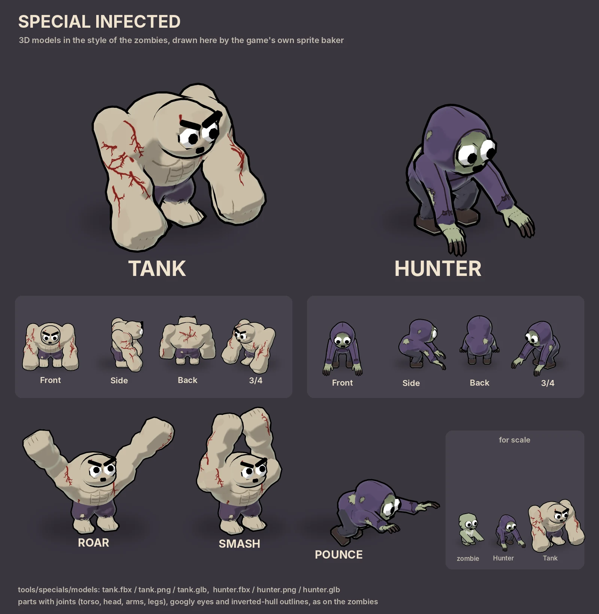

# The special infected's models

The **Tank** and the **Hunter** as 3D models, made the way the artist's zombies are (the horde's
models: `tools/zombies/source/zombies.fbx` and `docs/ZOMBIE-MODELS.md` on the zombie-models branch),
so they can stand in the same crowd: chunky low-poly pieces, big googly eyes, a black outline round
every piece, a flat hand-inked texture. After the concept sheet: the Tank a hulking brute knuckling
along on fists the size of its head, the Hunter a wiry thing in a torn hoodie, the hood up, crouched
to pounce.



(The sheet is drawn by the game's own sprite baker, `src/render/zombie-bake.js` on the zombie-models
branch, with the zombies' toon light and rim, next to a common zombie for scale. The poses are the
parts turned at their joints, the pounce the whole body tipped forward.)

## The files

In `tools/specials/models/`:

| File | What |
|---|---|
| `tank.fbx`, `hunter.fbx` | the model, laid out as `zombies.fbx` is: Blender's binary FBX 7.4, Y up, centimetres, one Phong material with the texture as its diffuse colour, found by relative path (keep the PNG beside it) |
| `tank.png`, `hunter.png` | the texture, 2048 px |
| `tank.glb`, `hunter.glb` | the same in one glTF 2.0 file (metres, the texture inside), to open anywhere |
| `sheet.webp` | the sheet above |

All four import into Blender 5 (checked: every part, its UVs, the material and its texture, the
parenting; FBX and GLB come in at the same size and pose). The outlines need back faces culled, as
in the game, Blender's viewport (Backface Culling) or a glTF viewer. Cycles traces light instead,
and each shell then shades the skin inside it (the zombies' FBX goes black the same way): make the
material see-through to back faces and to every ray but the camera's (Geometry: Backfacing and
Light Path: Is Camera Ray into a mix with a Transparent BSDF).

## Parts

Each model is six objects, each with its origin at its joint, the head, arms and legs children of
the torso. A part is modeled in its own frame the zombies' way (an arm points forward from its
shoulder, so the game's arm pitch works on it unchanged), and its object rotation is the pose it
stands in: rotate an arm or the head to pose it.

| Part | Tank | Hunter | Joint |
|---|---|---|---|
| torso | chest, belly, the hump of its back, the shoulders; the shorts are a garment of their own over the hips and thighs | the hoodie's body, hunched forward; the thighs, bent, in trousers | the ground under its middle |
| head | a squat domed skull, heavy brow, angry black brows, googly eyes, a small mouth | the hood, peaked, flopping back, dark inside; the face set in it; googly eyes, a small mouth | the neck: Tank (180, 0, 368), Hunter (92, 0, 214) |
| arm_l, arm_r | upper arm, forearm, a fist with knuckles and a thumb (mirror images) | a baggy sleeve bent at the elbow, a bony hand, four long clawed fingers and a thumb | the shoulder: Tank (10, ±236, 446), Hunter (58, ±84, 218) |
| leg_l, leg_r | a thick shin, a broad foot with toes | the shin in trousers, a shoe | under the foot: Tank (8, ±92, 0), Hunter (40, ±66, 0) |

Joints are in the zombies' axes and units: a forward, c to the right, h up, model units (the FBX's
centimetres), the ground at h = 0. In the standing pose the arms hang down and forward until the
Tank's knuckles and the Hunter's hands rest on the ground (the build works out that pitch: Tank
-0.96, Hunter -0.56 radians, the arms a little apart), and the Hunter's head looks a little down.

How big: a zombie stands about 410 tall (its head is most of that). The Tank stands 596 tall and,
arms and all, 742 wide; the Hunter, crouched, 415 tall to the top of its hood. At the zombies'
`SCALE` (0.1 world units a model unit) the Tank's shoulders come at about 45 and its head at 60,
where its stick figure has them (52 and 61); the Hunter's hood at 41.

## Like the zombies

- **Pieces**: closed solids (sculpted blobs, chamfered boxes, tubes), each with its outline shell,
  an inverted hull: the same shape pushed out 7.5 (Hunter) or 9 (Tank) model units with its faces
  turned in, coloured from the palette's black (the zombies' are 6 to 10). With back faces culled
  (the game's baker, glTF's default) it draws the black rim. Pupils, mouths and brows have none.
- **Googly eyes**: domed octagonal whites in the palette's white with flat octagonal pupils in its
  black, facing forward, the size of the zombies' (the Tank's a radius of 47, the Hunter's 36,
  theirs 43), so the game's eye poses (pupils rolling, blinking, crossed) fit them. The pieces are
  named `eyeL_white`, `eyeL_pupil` and so on, which the game format turns into the zombies' eye tags.
- **The texture**: the zombies' palette strip sits exactly where theirs does (u 0 to 0.07, v 0.85 to
  1: eye white, tan, dark red, black), so the game's palette rule (those UVs never move) holds.
  Everything else is painted flat with ink lines, as theirs is. One look each, so no colour blocks.
- **Size**: in proportion to the zombies (above), so they can share a scene.

## The look

- **Tank**: pale, stone-coloured skin split by red fissures (down the arms, an X across the biceps
  and over the upper back, over the shoulders), muscle lines in a darker tone (under the pecs, the
  abs, the spine and shoulder blades), lines between the fingers of each fist and the toes; torn
  dark purple shorts: ragged hems with the thigh showing, holes, seams, scribbled hatching.
- **Hunter**: a purple hoodie, the hood up (a seam over the top, dark inside the opening), torn at an
  elbow, up the other arm, at a shoulder blade, a shoulder and the side of the hood (skin showing
  through, each tear inked round), a kangaroo pocket, ragged cuffs; a grey-green face in the hood's shadow; long fingers
  ending in dark claws; dark trousers torn at the knee, frayed at the ankle; shoes with laces.

## Building

```
python3 tools/specials/build_specials.py [--out DIR] [--game]
```

(numpy and Pillow, about 40 s) builds both from code and writes the files above; the same files
every time. With `--game` it also writes `specials.js`: the parts in the zombies' mesh format
(`assets/zombies/meshes.js`: positions, normals, UVs and triangles as base64 typed arrays, relative
to each part's joint, triangles wound for the baker's culling, the eye tags on the heads), what the
game's baker draws. The sheet was drawn from it.

| File | What it does |
|---|---|
| `tools/specials/kit.py` | the modeling kit: chamfered and rounded boxes, shapes sculpted from signed distance fields into low-poly meshes, tubes, googly eyes, outline shells, normals |
| `tools/specials/figure.py` | parts and their joints, the standing pose (arms resting on the ground) |
| `tools/specials/tank.py`, `hunter.py` | the two designs |
| `tools/specials/atlas.py` | UVs: charts by which way the faces look, packed round the palette strip; each texel's point on the model; padding round the islands |
| `tools/specials/paint.py` | the paint, done in 3D: flat colours, ink strokes, cracks walked over the surface, tears, hatching |
| `tools/specials/export_files.py` | the FBX and GLB writers |
| `tools/specials/export_game.py` | the game's mesh format |

To change a model, change its design file (shapes are a few ellipsoids, capsules and boxes each)
or its paint and build again. An artist can also take the FBX into Blender from here: each part
keeps its origin at its joint.

## Into the game

They aren't in the game yet: the Tank and the Hunter are still drawn as figures
(`src/render/figures.js`). The horde's models and their baker live on the zombie-models branch. With
that merged, `--game` gives the baker everything it needs, and what's left is the drawing, as
`src/render/zombie-art.js` does it for the horde: sprites per facing and arm pose, and poses for
their moves (the Tank's walk, punch and throw; the Hunter's stalk, crouch, leap, pin and stagger).

`tests/special-models.test.js` checks the files: the textures and their palette strip, the GLBs
(every part, whole meshes, outline shells, UVs on the texture, standing on the ground, the right
height) and the FBXs (version, Blender's footer, a model per part).
